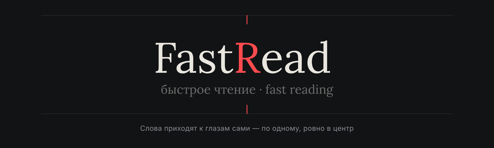
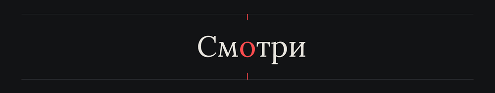
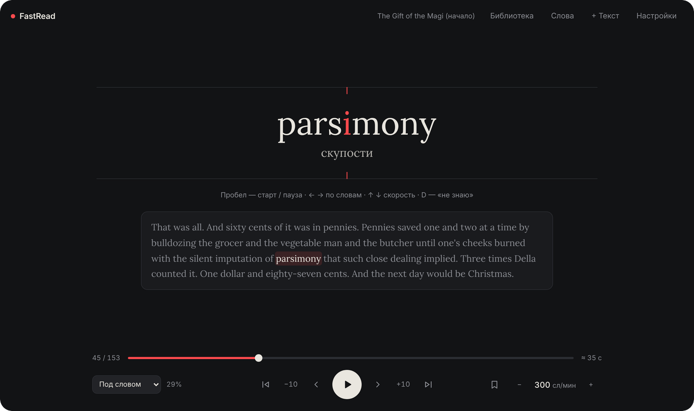
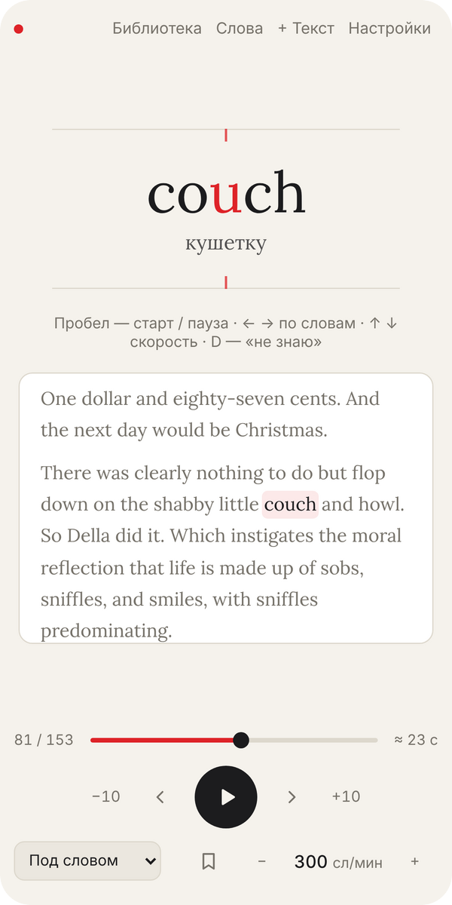
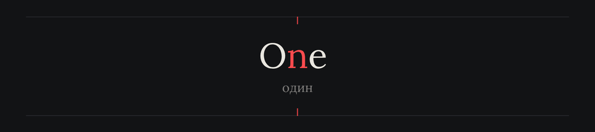
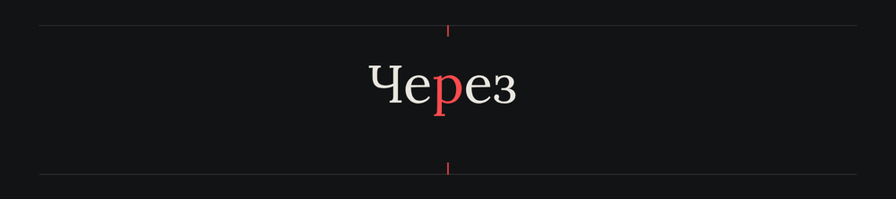
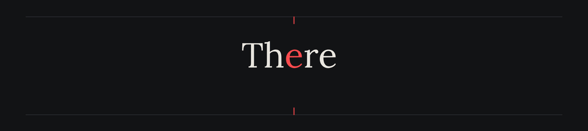
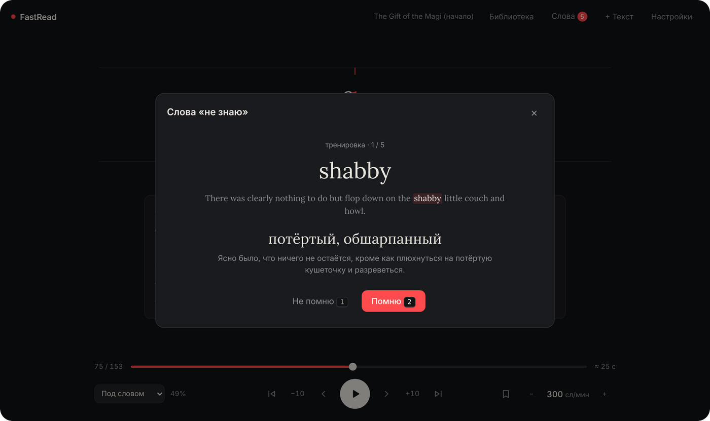

<p align="center">
  <picture>
    <source media="(prefers-color-scheme: dark)" srcset="docs/banner-dark.png">
    <source media="(prefers-color-scheme: light)" srcset="docs/banner-light.png">
    
  </picture>
</p>

<p align="center">
  
  
  
  
  <a href="LICENSE"></a>
</p>

<p align="center">
  
</p>

<p align="center">
  RSVP-читалка: слова появляются по одному, и каждое встаёт <b>красной буквой ровно в центр</b>.<br>
  Глазу не нужно бегать по строкам, текст сам идёт к нему. А двуязычные режимы помогают учить язык прямо во время чтения.
</p>

---

### Чтение

<table>
<tr>
<td width="72%"></td>
<td width="28%"></td>
</tr>
</table>

- **Фокусная буква**: середина слова (при чётной длине левая из двух) или «чуть левее», как в Spritz. Пунктуация висит снаружи и центр не сдвигает.
- **Пунктуация держится за слово**: `слово,` · `«Кто-то»` · `— Привет` · `Москва —`. На запятых и точках слово показывается чуть дольше.
- **Длинные слова делятся по слогам**: `Достопри- мечатель- ность`.
- **На паузе** виден кусок текста: клик по любому слову продолжает чтение с него.
- **Файлы**: `txt` · `md` · `fb2` · `epub` · `html` (windows-1251 определяется сама). Библиотека помнит, где ты остановился в каждой книге.

### Учить язык, читая

<table>
<tr>
<td width="50%" valign="top"><b>Перевод под словом</b><br><sub>Полупрозрачный перевод в контексте. Можно включить проявление с задержкой и только для слов твоего уровня (A1–C2): сначала попробуй понять сам.</sub><br><br></td>
<td width="50%" valign="top"><b>Вкрапления</b><br><sub>Русский текст, часть слов заменена английскими. Смысл понятен из контекста, плотность от 1 до 5.</sub><br><br></td>
</tr>
<tr>
<td valign="top"><b>Перевод предложений</b><br><sub>Читаешь предложение потоком, после точки на мгновение виден его перевод целиком.</sub><br><br></td>
<td valign="top"><b>Колода «не знаю»</b><br><sub>Жми <kbd>D</kbd> на незнакомом слове, и оно попадёт в карточки с предложением. Дальше интервальное повторение, тренировка трудных слов и экспорт в Anki.</sub><br><br></td>
</tr>
</table>

Работает в обе стороны: английский текст с русскими подсказками или русский с английскими. Два примера встроены, они открываются в **«+ Текст»**: *The Gift of the Magi* О. Генри и «Хамелеон» Чехова.

### Быстрый старт

```bash
git clone <repo> && open FastRead/index.html     # вот и всё
```

### Свои тексты

Двуязычный текст — это **пак**: JSON, где у каждого слова есть перевод в контексте, начальная форма и уровень, а у предложений — перевод целиком. Готовить паки удобнее LLM-агентом:

1. Дай агенту промпт из [`agents/PACK_PROMPT.md`](agents/PACK_PROMPT.md) и текст.
2. Проверь результат: `python3 tools/validate_pack.py pack.json`. Книгу можно разметить частями и склеить через `--merge book.json part1.json part2.json …`.
3. Перетащи `.json` в окно читалки.

<details>
<summary><b>Формат пака</b></summary>

```jsonc
{
  "format": "fastread-pack/1",
  "title": "The Gift of the Magi",
  "lang": "en", "gloss_lang": "ru", "learn": "en",
  "paragraphs": [[                                  // абзацы → предложения
    {
      "text": "Three times Della counted it.",
      "tr":   "Делла пересчитала их три раза.",
      "words": [
        { "w": "Three",   "l": "three", "g": "три",          "lvl": "A1" },
        { "w": "times",   "l": "time",  "g": "раза",         "lvl": "A1" },
        { "w": "Della",   "l": "Della", "g": "Делла" },
        { "w": "counted", "l": "count", "g": "пересчитала",  "lg": "считать", "lvl": "A2" },
        { "w": "it.",     "l": "it",    "g": "их",           "lvl": "A1" }
      ]
    }
  ]]
}
```

`g` — перевод в контексте, `lg` — словарный перевод для карточки, `p` — фраза или идиома, `sw` / `sd` — замена и её очерёдность для вкраплений. Полное описание — в [`agents/PACK_PROMPT.md`](agents/PACK_PROMPT.md).
</details>

### Клавиши

<kbd>Пробел</kbd> старт/пауза · <kbd>←</kbd><kbd>→</kbd> слово (<kbd>Shift</kbd> — 10) · <kbd>[</kbd><kbd>]</kbd> предложение · <kbd>↑</kbd><kbd>↓</kbd> скорость · <kbd>D</kbd> не знаю · <kbd>M</kbd> режим · <kbd>W</kbd> слова · <kbd>L</kbd> библиотека · <kbd>N</kbd> новый текст

<details>
<summary><b>Структура проекта</b></summary>

```
index.html                 приложение целиком: HTML + CSS + JS, примеры встроены
examples/                  паки-примеры (EN→RU, RU→EN)
agents/PACK_PROMPT.md      промпт для агентов, которые размечают тексты
tools/validate_pack.py     проверка и склейка паков (чистый Python)
tools/embed_examples.py    встраивает examples/*.json в index.html
docs/                      картинки для README
```

Данные хранятся только в браузере (IndexedDB). Для EPUB при первой загрузке нужен интернет (JSZip с CDN), всё остальное работает офлайн.
</details>

<p align="center"><sub><a href="LICENSE">MIT</a> © 2026 Herman Edelkin · тексты примеров — общественное достояние: O. Henry (1905), А. П. Чехов (1884).</sub></p>
